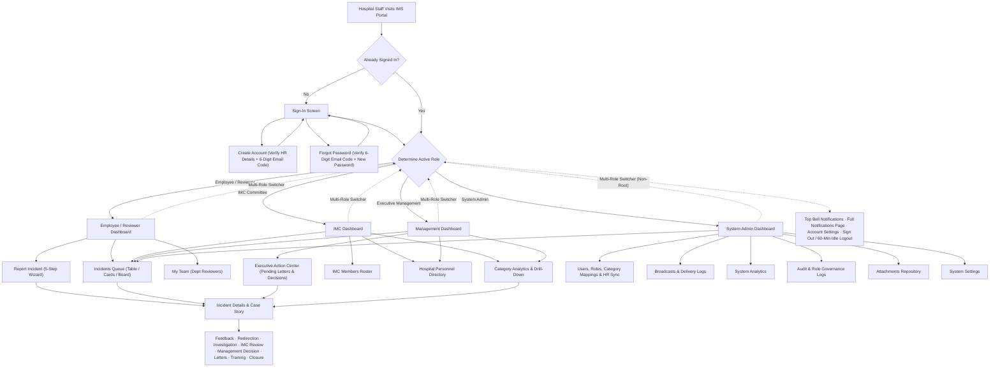

# Jaiprakash Hospital & Research Centre (JPHRC)
# Incident Management System (IMS) — Functional Specification Document

**Document Type:** Functional Specification Document (FSD)  
**Target Audience:** Hospital Management, Quality & Safety Leadership, Incident Management Committee (IMC), Department Heads, QA Testers, and End-Users  
**Scope:** Complete end-to-end functional behaviour of the live JPHRC Incident Management System as currently implemented.

---

## 1. Executive Overview & Scope

### 1.1 Purpose & Core Problem Solved
The **JPHRC Incident Management System (IMS)** is an internal hospital governance platform used by **Jaiprakash Hospital & Research Centre Pvt. Ltd.** to report, review, investigate, resolve, and audit clinical, operational, safety, administrative, and facility incidents across hospital locations.

It replaces fragmented paper forms, email chains, and manual follow-ups with a single structured accountability workflow that ensures:
- Every staff member can report an incident within policy timelines with supporting evidence.
- Incidents are automatically routed to the staff assigned to review each specific incident category.
- Serious or unclear cases can be redirected, expanded to additional categories, escalated in priority, or formally investigated by a joint panel.
- The Incident Management Committee (IMC) assesses severity and recommends structured outcomes, while Executive Management issues binding directives (including mandatory financial penalty amounts where applicable).
- Formal communication letters (warnings, penalties, advisories, suggestions, trainer appointments) are drafted on official hospital letterhead, approved, permanently locked as PDF documents with QR verification links, and dispatched to recipients and copied (CC) staff.
- Mandated corrective training is tracked end-to-end from trainer appointment through attendance verification and final management sign-off.
- Leadership has real-time dashboards, category turnaround analytics, communication logs, an attachment repository, and an immutable activity audit trail.

### 1.2 Summary of Built Modules
1. **Authentication & Account Security:** Individual employee sign-in, self-registration verified against the hospital HR directory (OfficePortal), one-time verification code (OTP) flows, password reset/change, automatic inactivity sign-out, multi-role switching, and immediate session termination on deactivation or HR lockout.
2. **Role-Tailored Dashboards:** Dedicated landing dashboards for Employees, Department/Category Feedback Reviewers, IMC Committee, Executive Management, and System Administrators.
3. **Incident Reporting (5-Step Guided Form):** Structured capture of incident categories & types, date/time/location, narrative & evidence attachments, responsible personnel, and final review.
4. **Incident Queue, Tracking & Export:** Role-scoped incident lists with Table, Card, and column-based Board views, search, multi-filter panel, overdue indicators, column customization, and Excel workbook export.
5. **Incident Details & Chronological Case Story:** Complete case dossier with chronological timeline ledger, interactive workflow mini-map, feedback editing, redirection review, additional category involvement, priority escalation, joint investigation workflow, IMC quality assessment, Executive Management governance directives, and case reopening.
6. **Formal Official Letters:** Multi-template official hospital letterhead editor, live preview, penalty amount synchronization, active-employee CC directory search, Management approval/revision loop, locked PDF archival, QR verification link, and automated email/in-app dispatch.
7. **Mandatory Training & Corrective Action (CAPA):** Trainee selection, trainer appointment with automatic appointment letter dispatch, training completion reporting with attendance evidence, IMC verification/rework loop, and Management final closure.
8. **Notifications, My Team, Personnel Directory & Account Settings:** Real-time notification bell and inbox, department team overview for Department Reviewers, read-only Hospital Personnel Directory, and account profile/password management.
9. **Analytics & Category Performance:** Hospital-wide SLA/resolution analytics, 12-month trend charts, severity breakdowns, per-category response/resolution metrics, and category drill-down incident logs.
10. **System Administration:** Staff Directory & account activation/deactivation, System Admin/IMC/Management role governance, 27-category feedback staff mapping, OfficePortal HR directory synchronization, hospital-wide broadcast announcements & delivery logs, activity & role governance audit logs (with spreadsheet export), centralized attachments repository (with bulk ZIP download), and System Settings.

---

## 2. User Roles & Permissions Matrix

### 2.1 User Roles & Special Designations

| Role / User Type | Description & How Assigned | Default Landing Screen |
| :--- | :--- | :--- |
| **Unauthenticated Visitor (Guest)** | Any person not signed in. Can only access the Sign-In, Create Account, and Password Reset flows. All other links redirect to Sign-In. | Sign-In screen |
| **Employee (Regular Staff)** | Standard active hospital staff member synced from OfficePortal HR records who has created an IMS account. | Employee Dashboard |
| **Category Feedback Reviewer** | Any active hospital employee mapped by a System Administrator to one or more of the 27 Incident Categories. Retains their regular Employee role (not forced to Department Head) while gaining a Reviewer View on their Dashboard and the ability to provide category feedback or request redirection on linked incidents. | Employee Dashboard (defaults to Reviewer View) |
| **Department Reviewer (Legacy HOD)** | Staff whose HR designation indicates Head of Department or who are mapped to a legacy department leadership/reviewer list. Has all Employee and Reviewer capabilities plus access to **My Team**. | Employee Dashboard (defaults to Reviewer View) |
| **IMC Committee Member** | Hospital staff granted IMC membership by a System Administrator. Can view all hospital incidents, view the Hospital Personnel Directory, view Category Analytics and IMC Members, serve as a Primary Investigator, and generate printable summaries. Cannot perform Convenor-only approvals/assessments. | IMC Dashboard |
| **IMC Lead / Convenor** | An IMC Committee Member additionally designated as **Lead / Convenor** by a System Administrator. Holds full committee decision authority: approve/reject redirections, involve additional categories, escalate priority, appoint investigation panels, review investigation reports, submit IMC quality assessments, draft/submit formal letters, assign trainers, and verify completed training. | IMC Dashboard |
| **Executive Management** | Senior hospital leadership granted Management access by a System Administrator. Reviews IMC assessments, issues final governance directives (approve, modify, reject for re-investigation/revision), sets required financial penalty amounts, approves or returns formal letters, performs post-training final case closure, reopens closed cases, and views hospital-wide analytics and the Personnel Directory. | Management Dashboard |
| **System Administrator (Employee Admin)** | Hospital staff granted administrative privileges. Signs into their Staff View by default and switches to System Admin via the sidebar menu. Manages users, role assignments, category feedback mappings, HR sync, broadcasts, delivery logs, audit logs, attachments, and system settings. | Staff Dashboard (switches to Admin Dashboard via sidebar) |
| **Root System Administrator (ID: 00000)** | Built-in master administrative account exempt from HR directory sync lockouts. Always signs directly into System Admin, has no Staff View, cannot be deactivated or revoked, and is the only account permitted to edit its own recovery email address inside Account Settings. | System Admin Dashboard |

> **Multi-Role Switching:** Staff holding more than one access level (for example, an employee who is also an IMC Member, Management Member, or System Administrator) sign in with a single personal Employee ID and switch seamlessly between their authorized views from the sidebar footer. Legacy shared committee logins are permanently retired.

### 2.2 Permissions Matrix

*Legend: **Own / Scope** = Only incidents reported by the user, assigned to them (review, investigation, training, responsible person), or where they are a primary/CC recipient of an approved letter. **All** = All hospital incidents. **—** = Not permitted.*

| Module / Capability | Guest | Employee | Category / Dept Reviewer | IMC Member | IMC Lead / Convenor | Executive Management | System Admin |
| :--- | :---: | :---: | :---: | :---: | :---: | :---: | :---: |
| **Sign In / Register / Forgot Password** | Yes | — | — | — | — | — | — |
| **Report New Incident** | — | Create | Create | Switch to Staff View | Switch to Staff View | Switch to Staff View | Switch to Staff View *(non-root)* |
| **View Incidents List & Details** | — | View (Own / Scope) | View (Own / Scope) | View (All) | View (All) | View (All) | View (All) |
| **Withdraw Incident (Before IMC Review)** | — | Own Reported | Own Reported | — | — | — | — |
| **Submit Category / Dept Feedback** | — | Mapped Scope Only | Mapped Scope Only | Mapped Scope Only | Mapped Scope Only | Mapped Scope Only | Mapped Scope / Override |
| **Request Redirection to IMC** | — | Mapped Scope Only | Mapped Scope Only | Mapped Scope Only | Mapped Scope Only | Mapped Scope Only | Mapped Scope / Override |
| **Edit Own Feedback (Before Next Stage)** | — | Own Only | Own Only | Own Only | Own Only | Own Only | Own Only |
| **Approve / Reject Redirection** | — | — | — | — | Approve / Reject | — | Approve / Reject |
| **Involve Additional Categories** | — | — | — | — | Edit | — | Edit |
| **Escalate Incident Priority** | — | — | — | — | Yes (Exclusive) | — | — |
| **Appoint / Reassign Investigation Panel** | — | — | — | — | Create / Edit | — | Create / Edit |
| **Submit Joint Investigation Report** | — | — | — | Primary / IMC | Primary / IMC | — | Yes |
| **Submit IMC Quality Assessment** | — | — | — | — | Create | — | Create |
| **Submit Executive Management Decision** | — | — | — | — | — | Approve / Modify / Reject | Approve / Modify / Reject |
| **Draft / Edit / Delete / Submit Letters** | — | — | — | — *(not available on screen)* | Create / Edit / Delete | — | Create / Edit / Delete |
| **Approve & Dispatch / Return Letters** | — | — | — | — | — | Approve / Return | Approve / Return |
| **View / Download Approved Letters & PDFs** | — | Recipient / CC Only | Recipient / CC / Dept | View (All) | View (All) | View (All) | View (All) |
| **Assign Trainer & Issue Appointment Letter** | — | — | — | — | Create | — | Create |
| **Submit Training Completion Report** | — | Assigned Trainer Only | Assigned Trainer Only | Assigned Trainer Only | Yes | — | Yes |
| **Verify Training / Request Rework** | — | — | — | — | Approve / Return | — | Approve / Return |
| **Confirm Training & Officially Close Case** | — | — | — | — | — | Approve & Close | Approve & Close |
| **Reopen Resolved / Closed Incident** | — | — | — | — *(Server blocks)* | Yes | Yes | Yes |
| **Export Incidents to Excel** | — | — *(unless Reviewer)* | Export (Scope) | Export (All) | Export (All) | Export (All) | Export (All) |
| **View My Team** | — | — | Dept Reviewer Only | — | — | — | — |
| **View Hospital Personnel Directory** | — | — | — | View | View | View | View *(via direct link)* |
| **View Category & System Analytics** | — | — | — | Category Analytics | Category Analytics | Category & System Analytics | System Analytics |
| **Manage Users, Roles, Mappings & HR Sync** | — | — | — | — | — | — | View / Edit / Revoke |
| **Send Broadcasts & View Delivery Logs** | — | — | — | — | — | — | View / Create |
| **View & Export Audit Logs** | — | — | — | — | — | — | View / Export |
| **Manage Attachments Repository & Bulk ZIP** | — | — | — | — | — | — | View / Download |
| **Configure System Settings** | — | — | — | — | — | — | View / Edit |
| **Change Own Account Password** | — | Yes | Yes | Yes | Yes | Yes | Yes |
| **Edit Own Recovery Email** | — | — *(HR Managed)* | — *(HR Managed)* | — *(HR Managed)* | — *(HR Managed)* | — *(HR Managed)* | Root Admin (`00000`) Only |

---

## 3. Application Architecture & Navigation Flow (Non-Technical)

### 3.1 Screen Hierarchy & Role Menus

Every signed-in user sees a consistent workspace shell consisting of:
- **Top Staging Banner (Staging/Test Environment Only):** An amber full-width notice stating *"STAGING / TEST ENVIRONMENT | Data entered here is isolated and will NOT affect Production"*.
- **Top Header Bar:** Mobile menu toggle on smaller screens, hospital tagline (*"Jaiprakash Hospital & Research Centre · Quality Health Care at Affordable Price"*), and the **Notification Bell** (with unread count badge up to `9+`).
- **Left Navigation Sidebar:** Hospital branding, signed-in user profile card (avatar initial, full name, Employee ID, active role badge), role-specific navigation links, multi-role switch buttons (if applicable), **Settings**, and **Sign Out**.

**Navigation Links by Active Role:**
- **Employee:** Dashboard · Incidents · Settings · Sign Out
- **Department Reviewer:** Dashboard · Incidents · My Team · Settings · Sign Out
- **IMC Committee (Member & Lead/Convenor):** Dashboard · Incidents · Category Analytics · IMC Members · Employee Directory · Settings · Sign Out
- **Executive Management:** Dashboard · Incidents · Category Analytics · Employee Directory · Settings · Sign Out
- **System Administrator:** Dashboard · Incidents · Users & Mappings · Communications · Analytics · Audit Logs · Attachments · System Settings · Settings · Sign Out

**Sub-Screens & Pop-up Modals Accessible from Primary Screens:**
- From **Dashboard / Incidents:** Report New Incident (5-step wizard), Quick View Incident Details pop-up (from Staff Dashboard), Export Incidents Report pop-up, Incident Details & Case Story screen.
- From **Incident Details:** Withdraw pop-up, Edit Incident pop-up, Submit Feedback pop-up, Edit Own Feedback pop-up, Request Redirection pop-up, Reject Redirection pop-up, Involve Category pop-up, Escalate Priority confirmation, Management Decision pop-up, Draft/Edit Letter pop-up (Editor + Official Letterhead Preview tabs), Letter Viewer pop-up, Return Letters for Revision pop-up, Assign Trainer pop-up, Submit Training Report pop-up, Verify/Rework Training pop-ups, Trainer Appointment Letter pop-up, Reopen Incident pop-up, File Attachment Preview pop-up.
- From **Category Analytics:** Category Detail Drill-Down screen (category KPIs and non-withdrawn incident log).
- From **My Team / Employee Directory / Staff Directory:** Full-screen Staff Profile & Activity view.
- From **Users & Mappings:** 6 tabs (*Staff Directory*, *System Admins*, *IMC Committee*, *Management*, *Category Mapping*, *HR Sync & Connection Health*), Configure Role pop-up, Assign Category Staff pop-up, Activate/Deactivate & Role Revocation confirmations.
- From **Communications:** 2 tabs (*System Broadcasts*, *Email & Delivery Logs*), New Broadcast pop-up, Message/Error Detail pop-up, Broadcast Attachment Preview pop-up.
- From **Audit Logs:** 2 tabs (*System Activity Ledger*, *Role Governance History*).
- From **Attachments:** Expandable incident rows, File Preview pop-up, Bulk ZIP download.

### 3.2 Plain-English User Navigation Flow

---

## 4. End-to-End Functional Workflows (Module by Module)

### 4.1 Authentication & Account Access

#### Screen: Sign-In, Create Account & Password Reset
- **Purpose:** Authenticates individual hospital staff, lets first-time staff activate their IMS account against HR records, and enables self-service password recovery.
- **Sign-In Mode (Default):**
  - Displays `Employee ID` field, `Password` field (with show/hide eye button), `Forgot Password?` link, `Sign In` button, and tab/toggle to `Create Account`.
  - Clicking **Sign In** validates that both fields are filled, checks credentials against the system, confirms the employee is active in HR records and not manually deactivated, and routes the user to their role's default dashboard.
  - If the server takes longer than 8 seconds to respond, an amber banner appears: *"Still connecting… The server is taking longer than usual to respond. Please wait a moment."*
- **Create Account Mode:**
  - **Step 1:** Captures `Full Name` (as in hospital HR records), `Employee ID`, `Official Email Address` (must match the official email registered in OfficePortal HR), and `Set Password` (with show/hide toggle). Clicking **Create Account** checks the submitted details against active HR records and sends a 6-digit verification code to the official HR email address.
  - **Step 2 (Verify Email):** Displays `Back to Sign Up` button, a 6-digit `Enter OTP` input, the masked/shown target email caption, and `Verify & Create Account`. Submitting a valid code creates the account, dispatches a welcome email, returns to Sign-In with the Employee ID and password pre-filled, and displays a success banner.
- **Forgot Password Mode:**
  - **Step 1:** Displays `Back to Sign In`, `Employee ID`, `Registered Email Address`, and `Send Reset OTP`. Submitting always displays a uniform privacy-safe confirmation message (*"If your details match an active registered account, a verification OTP has been sent to the registered email."*) so external users cannot probe valid accounts.
  - **Step 2:** Displays `Enter OTP` and `New Password` (with show/hide toggle) and `Set New Password & Sign In`. Upon valid verification (and ensuring the new password differs from the current one), updates the password, invalidates all existing active sessions, and returns to the Sign-In form with the Employee ID preserved and the password field cleared.
- **Role Switching & Sign Out:**
  - Multi-role staff click `Switch to System Admin`, `Switch to IMC`, `Switch to Management`, or `Switch to Staff View` in the sidebar footer. The system verifies active status, clears previously loaded data from the previous view, switches active permissions, and opens the target dashboard.
  - Clicking **Sign Out** ends the session on the server, clears local session data, signs out any other open tabs in the same browser, and redirects to Sign-In.

---

### 4.2 Role-Tailored Dashboards

#### A. Employee & Reviewer Dashboard
- **Purpose:** Provides staff with an immediate summary of their reported incidents and, for mapped Category/Department Reviewers, their assigned review workload.
- **Regular Employee View:**
  - Displays welcome banner with **Report Incident** button.
  - **My Incidents Overview (4 clickable cards):** `Total Incidents` (excludes withdrawn), `Active`, `Resolved`, and `Withdrawn`. Clicking any card opens the Incidents Queue pre-filtered to that status.
  - **Recent Incidents Table (latest 5):** Shows Reference ID (with attachment count badge, `ESCALATED` badge if escalated, and `Overdue` badge if open for 7+ days), Category, Reported Date, Incident Date & Time, Location, Status, and a **View** button.
  - Clicking **View** opens a **Quick View Incident Details** pop-up showing core incident facts and read-only Department, IMC, and Management feedback threads (hidden if withdrawn), with a **View or Feedback** button to open the full Incident Details screen.
  - **Quick Action Tile:** `All Incidents`.
- **Reviewer View (shown by default when user is a Department Reviewer or mapped Category Feedback Reviewer):**
  - Top **View Switcher** toggles between `Reviewer View` and `Personal View`.
  - **Assigned Incident Category Scope Banner:** Displays assigned categories; if assigned to multiple categories (or multiple legacy departments), provides clickable scope pills and a dropdown filter to slice dashboard counts and recent incidents by a single category.
  - **Assigned Review Overview:** `Received Incidents`, `Active Incidents`, `Resolved` cards plus `Withdrawn` pill.
  - **Department Feedback Tracker:** Two clickable cards — `Pending Feedback` and `Feedback Given` — drilling straight into the Incidents Queue.
  - **Analytics Charts:** 12-Month Incident Trend bar chart, Severity Distribution donut chart, and Top 10 Incidents by Type horizontal bar chart.
  - **Recent Incidents Table (latest 5):** Expanded view adding Reporter Name, Reporter Department, and Employee ID.

#### B. IMC Committee Dashboard
- **Purpose:** Gives the Incident Management Committee a hospital-wide overview of incident throughput, feedback bottlenecks, category analytics, and committee roster.
- **Header:** Includes an inline **Search employee…** bar that jumps directly to the Hospital Personnel Directory filtered by that term.
- **Tab 1 — Overview:**
  - **Overview Cards:** `Total Incidents` (valid/non-withdrawn), `Active Incidents`, `Resolved`, plus secondary clickable pills for `Letters Awaiting Approval` (when > 0), `Decisions Pending` (when > 0), `Grave`, `Redirects`, `Withdrawn`, and `Training Pending`.
  - **Accountability Pipeline Stepper:** 3-stage interactive tracker (`1. Department Feedback`, `2. IMC Feedback`, `3. Mgmt Feedback`) showing clickable `Pending` and `Completed` counts (with a green checkmark when pending reaches zero).
  - **Recent Incidents (latest 5):** Clickable rows with severity color indicator, Reference ID, badges, category, reporter, location, date, and `View` button.
  - **Charts:** 12-Month Incident Trend bar chart and Severity Distribution donut chart.
- **Tab 2 — Category Analytics:**
  - 3 Duration KPI cards: `Avg Dept Feedback Time`, `Avg IMC Feedback Time`, `Avg Resolution Time`.
  - Searchable, sortable **Category Analytics Table** covering all 27 active categories with columns: Incident Category, Received, Dept Feedback Given (% + progress bar), Pending Feedback (`View` link or `All done ✓`), Resolved (`All` badge when complete), Avg Dept Resp, Avg IMC Resp, and Avg Resolution. Clicking any category opens the **Category Detail Drill-Down** screen.
- **Tab 3 — IMC Members:**
  - Total IMC members count card, live search bar (name, ID, department), and read-only roster table showing Member Name (with `YOU` badge for self), Employee ID, Department, Designation, and Status (`IMC Convenor` or `IMC Member`).

#### C. Executive Management Dashboard
- **Purpose:** Surfaces executive governance actions requiring immediate sign-off alongside hospital-wide metrics and category performance.
- **Header:** Includes inline **Search employee…** bar and two top tabs (`Executive Overview` and `Category Analytics & Feedback Tracker`).
- **Tab 1 — Executive Overview:**
  - Same hospital-wide Overview KPI Cards & secondary pills as IMC.
  - **Executive Action Center (shown whenever letters or decisions await Management):** Two dedicated priority queues (up to 20 items each) — **"Letters Forwarded by IMC — Awaiting Approval & Dispatch"** (`Review & Approve →`) and **"IMC Reviewed — Awaiting Executive Decisions"** (`Provide Decision →`) — opening directly into each Incident Details screen.
  - **Accountability Pipeline Stepper** (Stage 3 labeled `3. Mgmt Review & Letter Approval`), Recent Incidents (latest 5), 12-Month Trend & Severity charts, and Quick Actions (`All Incidents`, `Analytics`).
- **Tab 2 — Category Analytics & Feedback Tracker:**
  - 3 Duration KPI cards (`Avg Dept Feedback Time`, `Avg IMC Feedback Time`, `Avg Resolution Time`).
  - **IMC Feedback Status Card:** Completion ring percentage, `IMC Feedback Given` card, `IMC Feedback Pending` card with quick-links to the top 3 pending incidents, and an expandable list of up to 25 IMC-reviewed incidents.
  - Full searchable/sortable **Category Analytics Table** drilling down to Category Detail.

#### D. System Administrator Dashboard
- **Purpose:** Gives System Administrators a high-level pulse of system activity and rapid navigation to administrative tools.
- Displays 4 KPI cards (`Total Incidents`, `Active`, `Resolved`, `Withdrawn`), `This Month` indicator pill, 3-stage Accountability Pipeline Stepper, 4 Quick Access tiles (`Users & Roles`, `Analytics`, `Audit Logs`, `System Settings`), 12-Month Trend & Severity charts, and Recent Incidents (latest 5).

---

### 4.3 Incident Reporting (5-Step Guided Wizard)

- **Purpose:** Enables Employees and Department Reviewers to log a new hospital incident cleanly without needing to know internal department routing.
- **Navigation Behaviour:**
  - Displays a 5-step progress bar (`1. Category & Type` → `2. Date, Time & Location` → `3. Details` → `4. Accountability` → `5. Review`).
  - **Back** returns to the previous step while preserving all entered answers (disabled on Step 1).
  - **Continue** validates only the current step's mandatory fields before advancing.
  - **Submit Incident** (Step 5) disables itself while submitting to prevent duplicates, creates the official Reference ID (`JPHRC/IMS/YYYY/0001`), sends automated notifications, displays a confirmation pop-up banner, and navigates directly to the new Incident Details screen.

**Step-by-Step Breakdown:**
1. **Step 1 — Category & Type:**
   - **Incident Category (Mandatory):** Searchable multi-select dropdown listing all **27 active hospital Incident Categories** (*Asset Related, Billing Related, Security Related, Biomedical Related, Blood Bank Related, Facility Related, Doctor Related, Consent Related, CSSD Related, Food and Beverages, General Maintenance related, Hospital Emergency Codes Related, HR Related, Housekeeping Related, Infection Control Related, Lab Related, Laundry and Linen related, Medication Related, Nursing Care Related, Purchase Related, Radiology Related, Store Related, Software/Hardware Related, Surgery or Procedure Related, Nursing Document Related, Vehicle and Ambulance Related, Accommodation Related*).
   - **Incident Type per Selected Category (Mandatory):** As each category is selected, a numbered searchable dropdown appears below it with the specific incident types belonging to that category (unselecting a category removes its type selection).
2. **Step 2 — Date, Time & Location:**
   - **Incident Date (Mandatory):** Date picker constrained to today and the preceding **14 calendar days** (future dates and incidents older than 14 days are blocked per hospital policy).
   - **Incident Time (Mandatory):** Time picker.
   - **Main Location (Mandatory):** Dropdown of hospital locations (*Dandiapali Main Hospital*, *Uditnagar City Center*, *Rajgangpur City Center*).
   - **Exact Sub-Location (Mandatory, appears after Main Location is chosen):** Free-text input (e.g., *"2nd Floor, Room 102"*); new sub-locations are recorded automatically if not already listed.
3. **Step 3 — Details:**
   - **Occurred To (Mandatory):** Dropdown with 6 options: *Patient*, *Hospital Employee*, *Visitor*, *Asset/Consumables*, *Process Flow*, *Others*.
   - **Description (Mandatory):** Multi-line narrative up to **2,000 characters** with live character counter.
   - **Attachments (Optional):** Drag-and-drop or click-to-browse uploader accepting up to **5 files**, maximum **2 MB per file**, in **JPG, JPEG, PNG, WebP, or PDF** format. Uploaded files appear in a list with file size, a clickable preview pop-up (with download), and a remove (`X`) button.
4. **Step 4 — Accountability:**
   - **Is anyone responsible for this incident?** Two toggle buttons: `Yes` / `No` (defaults to `No`; switching back to `No` clears any selected personnel).
   - **If `Yes` (Mandatory to select at least one person):**
     - Live hospital staff search bar (triggers after 2 characters) showing Name, Employee ID, Designation, and Department with `+ Add` / `Selected` states.
     - Selected staff appear as removable cards (no raw summary text input is shown).
     - Link **"Add person not listed in directory (e.g. Visitor, Contractor, Third-Party)"** (also offered inline when search yields zero matches) lets the reporter add an external/custom person's full name.
5. **Step 5 — Review:**
   - Info banner (*"Review Before Submitting"*) followed by a complete read-only summary of Categories & Types, Date & Time, Location, Occurred To, Description, Responsible Person(s) (or *"None identified"*), and Attachments (with preview and download links).

---

### 4.4 Incident Queue, Tracking, Board View & Excel Export

- **Purpose:** Central register to locate, filter, monitor, and export incidents within the user's authorized scope.
- **Header Controls:**
  - **Report Incident** button (for Employees & Department Reviewers).
  - **Export Report** button (for Reviewers, IMC, Management, and System Admins): Opens a pop-up allowing date selection (`Last 30 Days`, `Last 60 Days`, `Last 90 Days`, `All Time`, or `Custom Date Range` with Start/End Date), honors active Status/Severity/Category filters, and downloads a 20-column Excel (`.xlsx`) workbook covering metadata, all three feedback stages, turnaround time per stage, total duration, and description.
  - **View Switcher** (for Reviewers, IMC, Management, and System Admins): Switches between **Table View**, **Card View**, and **Board View** (5 fixed visual columns: *Submitted*, *Under Review*, *Action / Letters / Training*, *Resolved & Closed*, *Withdrawn*).
- **Scope Tabs (for Reviewers):** `Assigned Reviews` vs. `My Incidents`.
- **Search & Filter Panel:**
  - Live search bar (searches Reference ID, Category, Type, and Description; resets to page 1).
  - Collapsible Filters: **Status** (15 status options including *Active Unresolved* and *Resolved/Closed*), **Severity** (*Minor*, *Major*, *Grave*), **Category** (all 27 categories), **Date From**, **Date To**, and a **Clear Filters** button.
  - **Columns Customizer** (Table View): Lets users toggle visibility of table columns (remembered across visits in the browser). Note: the `Reporter (ID)` column is only visible to IMC, Management, and System Admins.
- **Sorting & Pagination:** Incidents are always ordered newest-first, paginated at **10 records per page** with `Previous` / `Next` controls. Active incidents open for **7 or more days** automatically display a red **Overdue** badge (`Overdue by Xd` or `Overdue by Xh`).

---

### 4.5 Incident Details & Chronological Case Story

- **Purpose:** Single workspace for reviewing an incident dossier, tracing every action chronologically, and performing role-authorized workflow actions. Active incidents refresh automatically every 8 seconds and whenever live updates occur; closed, resolved, or withdrawn incidents stop background refreshing.

#### Default Screen Layout
1. **Breadcrumbs & Incident Header:** Shows Reference ID, Status badge, Overdue badge (if ≥7 days open), pulsing red `ESCALATED BY …` badge (if escalated), Incident Type heading, Incident Date/Time, Location, Reporter Name, Severity badge, **Action Buttons** (role- and stage-specific), and **Generate PDF** button (for IMC and System Admins).
2. **Incident Registration & Reporting Details Card:**
   - Displays Incident Categories (if multiple categories are linked, shows a live `X of Y Responded` tracker with per-category *Feedback Given* vs. *Pending Review* indicators), Incident Type, Occurred To, Severity, Legacy Involved Departments (if any), full narrative Description, and clickable Submission Attachments (opening the inline File Preview pop-up with Download option).
3. **Editable Author Feedback Bar (Conditional):** Appears in indigo when the signed-in user has submitted feedback that is still unlocked, offering an **Edit Feedback** button.
4. **Case Chronological Story Ledger:**
   - Lists every recorded event in numbered chronological order (`#1, #2, …`) with actor role badge, actor name/department, timestamp, elapsed time delta since the previous event (`+Xh Ym` / `+Xd Yh`), expandable status transition badges, structured details, and event attachments.
   - **Controls:** Filter tabs (`All Story`, `Decisions`, `Investigation & Dept`, `Letters & Training`), live search bar across titles/actors/summaries/details, `System Activity` checkbox (off by default; reveals automated reminders and claim locks), and `Expand All / Collapse All` button.
   - **Privacy Rule:** Regular staff, reviewers, and reporters never see internal draft/revision letter events; they only see finalized approvals/dispatches.
5. **Active Workflow Action Area:** Dynamically displays the active stage panel (Redirection Review Card, Investigation Panel & Joint Report, IMC Quality Assessment, Post-Training Closure Review Banner, Formal Letters Card, Mandatory Training Card, or Official Closure Summary Card). *No persistent amber status/notification boxes or manual "Send Reminder" buttons appear on this screen.*
6. **Sticky Right Sidebar (Workflow Mini-Map):** Displays Reference ID with one-click copy, Status badge, Severity, live Turnaround Time, and a 6-step (or 7-step if investigated) clickable milestone roadmap that smoothly scrolls to and highlights the corresponding Case Story event.

#### End-to-End Case Actions
1. **Withdraw Incident (Reporter Only):** Available while awaiting initial review (`Submitted` or `Awaiting Department Feedback`). Clicking **Withdraw** opens a pop-up requiring a withdrawal reason. Confirming permanently marks the incident **Withdrawn** (irreversible).
2. **Submit Category / Department Feedback (Assigned Reviewer — Any Active Role):**
   - Any active hospital employee mapped to a linked Incident Category (regardless of whether their primary role is Employee, Department Reviewer, IMC, Management, or Admin) sees **Submit Feedback** until their assigned category responds and before IMC submits its quality review.
   - Opens a pop-up requiring detailed feedback text plus optional supporting attachments (up to 5 files, 2 MB each).
   - If multiple categories are linked, the incident waits until all mapped categories respond before automatically advancing to **Department Reviewed - Awaiting IMC** and notifying the IMC Committee.
3. **Request Redirection to IMC (Assigned Reviewer):**
   - Available once per incident before feedback is given and provided no prior redirection request was rejected.
   - Opens a pop-up requiring a justification explaining why the incident does not belong to the reviewer's scope. Submitting moves the incident to **Redirect Requested** and notifies IMC.
   - While **Redirect Requested**, the requesting reviewer cannot submit feedback, whereas reviewers of *other* categories linked to the same multi-category incident remain unblocked and can still submit their feedback without closing the open redirection request.
4. **Approve or Reject Redirection (IMC Lead / Convenor or System Admin):**
   - Appears in the **Redirection Request Review** card when status is **Redirect Requested**.
   - **Approve & Redirect:** Convenor selects one or more target **Incident Categories** (searchable multi-select) and chooses whether to check **"Retain requesting reviewer scope alongside newly selected categories (joint review)"** (Partial/Joint Redirect) or leave it unchecked (Full Redirect replacing the requesting category). Approving updates linked categories, clears stale redirect flags and legacy department links, notifies newly assigned category staff, and unlocks feedback for them immediately (or advances straight to IMC if all final linked categories already responded).
   - **Reject Request:** Opens a pop-up requiring a rejection reason, restores the incident to the original reviewer(s) (who cannot request redirection again), and notifies the requester.
5. **Involve Additional Categories (IMC Lead / Convenor or System Admin):**
   - Clicking **+ Involve Category** opens a pop-up listing currently linked categories and allowing multi-select addition of remaining active categories. Submitting attaches the new categories, returns the incident to department review so newly mapped staff can respond, and notifies them.
6. **Escalate Priority (IMC Lead / Convenor Exclusively):**
   - Clicking **Escalate Priority** opens a confirmation dialog (*"Mark incident … as high-priority escalated?"*). Confirming permanently flags the incident as escalated with the Convenor's name and notifies all active IMC and Management members (in-app and email).
7. **Edit Own Feedback (Author Only, Until Next Stage Begins):**
   - Department/Category & Investigator feedback can be edited until IMC or Management submits feedback.
   - IMC feedback can be edited until Management submits a decision.
   - Management feedback can be edited until the incident enters pending training, resolved, or closed state.
   - Opens **Edit Feedback** pop-up, records an audit-trailed `Feedback Edited` event with previous and updated text.
8. **Formal Investigation Panel (Optional — Triggered by IMC Lead / Convenor):**
   - Once all category feedback is received, IMC Lead toggles **Investigator Required?** to `Yes`.
   - Must select at least **1 Primary Investigator** (chosen from IMC Members) and may optionally add **Secondary Investigator(s)** (chosen from non-IMC active hospital staff; shows Notice Period warning if applicable).
   - Moves incident to **With Investigator** and notifies the panel. All panel members appear on the case; **Secondary Investigators** see a read-only notice, while **Primary Investigator(s)** (or IMC) submit a single centralized **Joint Investigation Report** (mandatory findings text + optional evidence attachments), advancing the case to **With IMC Review**.
   - IMC Lead reviews the joint findings and chooses:
     - **Yes, Satisfied:** Reveals the Final IMC Quality Assessment form inline to forward directly to Management.
     - **No, Need Re-investigation:** Requires remarks and lets the Convenor either **Send back to Same Team** or **Re-assign / Modify Investigators** (requiring ≥1 new Primary IMC member), returning the case to **With Investigator** with the previous report pre-filled for revision.
9. **IMC Quality Assessment (IMC Lead / Convenor):**
   - Requires: **Review & Findings** (mandatory text + optional attachments), **Assigned Severity** (*Minor*, *Major*, or *Grave*), and **Proposed Outcome(s)** (multi-select from 16 standard outcomes; *No Action* is mutually exclusive with all other outcomes).
   - Whenever an employee-directed outcome is chosen (e.g., *Issue a Warning Letter*, *Issue an Advisory Letter*, *Financial Penalty*, *Counselling / Education / Training*, *Suspension*, *Transfer*, *Demotion*, *Termination*, *Disciplinary Committee*), the **Responsible Employee(s) & Per-Employee Outcomes** selector appears and requires selecting at least one active employee, assigning specific outcomes per person (with an **Apply to All** shortcut when multiple staff are selected). For *Financial Penalty*, IMC sees a notice that *"Penalty amount decided solely by Management"*.
   - Submitting forwards the case to **IMC Reviewed - Awaiting Mgmt** and notifies Executive Management.
10. **Executive Management Decision & Governance:**
    - Clicking **Management Action** opens the governance pop-up with 4 options:
      - **Approve / Agree with IMC Recommendation:** Displays IMC outcomes and staff roster. If *Financial Penalty* is included, displays a **mandatory Penalty Amount (₹)** field directly on each penalized employee's card (or at the incident level if no responsible staff are listed) with live Indian Rupee words preview; **Submit Decision** stays disabled until every penalized staff member has an amount **greater than ₹0**.
      - **Modify Proposed Outcomes / Responsible Employees:** Lets Management alter overall outcomes, add/remove responsible staff, edit per-employee outcomes, and enter **mandatory positive Penalty Amounts (₹ > 0)** for every staff member assigned a Financial Penalty.
      - **Reject & Mandate Re-investigation:** Requires directive notes; returns the case to IMC Investigation Review (if a panel previously existed) or IMC Queue.
      - **Reject & Request Revised Quality Feedback:** Requires directive notes; returns the case to IMC Queue.
    - Optional directive notes and supporting attachments may be added on Approve/Modify.
    - **Automatic Workflow Routing After Approve / Modify:**
      - **Path A (Direct Closure):** *No Action* or institutional protocol outcomes only → immediately marks incident **Closed**.
      - **Path B (Formal Letters Only):** Warning, Advisory, Suggestion, Financial Penalty, Suspension, Transfer, Demotion, Termination, or Disciplinary outcomes (without training) → moves to **Drafting Letter(s)**.
      - **Path C (Mandatory Training Only):** Training / Counselling / Education outcomes (without letter outcomes) → moves to **Awaiting Trainer Assignment**.
      - **Dual Track (Letters + Training):** Both letter and training outcomes → moves to **Drafting Letter(s)** while enabling IMC to assign a trainer in parallel.
11. **Reopen Closed / Resolved Incident:**
    - Management or IMC Lead clicks **Re-open** (or **Reopen Incident for Exceptional Review** on the Closure Summary card), enters a mandatory reason, and moves the incident back to **Department Reviewed - Awaiting IMC**.

---

### 4.6 Formal Official Letters Module

- **Purpose:** Enables IMC Lead to draft standardized disciplinary/advisory notices on authentic JPHRC A4 hospital letterhead, route them for Executive Management sign-off, and dispatch permanent PDF copies to recipients and CC staff.
- **Involved Staff Roster:** Displays every responsible staff member, their already-drafted letter badges, and **Draft Letter for Staff** / **Draft Another Letter** buttons (supporting multiple letters for the same employee).
- **Drafting & Editing Pop-up:**
  - **Mandated Outcomes Banner:** Displays the employee's approved outcomes as one-click template switcher buttons (training outcomes appear as informational green badges).
  - **Controls:** Addressed Employee (locked when editing an existing draft), **Letter Template Type** (*Warning Letter*, *Warning & Financial Penalty Letter*, *Advisory Letter*, *Suggestion Letter*, *Custom Official Communication*), Recipient Designation, Department, Email Address (with warning badge if blank), Reference Number (auto-numbered `JPHRC/IMC/YYYY/001`), Letter Date, Subject Line (mandatory), and Letter Body Content (mandatory).
  - **Financial Penalty Box (for Penalty Templates):** Pre-fills the Management-approved penalty amount (₹) and auto-generated Rupee words (both editable), plus a **"Sync Clause in Body Text"** button to insert or update the deduction clause inside the letter body.
  - **Copy Forwarded To (CC Recipients — Active Employee Search Only):** Starts completely empty (zero predefined CC entries). Users search active hospital employees by **Name, Employee ID, Designation, or Department** and click `+ Add CC`. Selected staff appear as removable chips showing **`Full Name — Complete Designation`** plus an `Email` / `No email` indicator. Switching templates preserves selected CC staff; primary recipient and duplicates are prevented.
  - **Live Letterhead Preview Tab:** Renders the exact A4 hospital letterhead (`Doc. No.: JPHRC/GNR/FRM/004A`, JPHRC logo, NABH logo, watermark, `DRAFT — FOR REVIEW` stamp, To block, Subject, body, penalty box, sign-off block, numbered CC list formatted strictly as **`Full Name — Complete Designation`** [hidden when empty], clickable QR verification code, and Rourkela/Rajgangpur branch footer).
- **Draft Lifecycle:**
  - IMC Lead can **Edit** or **Delete** (with confirmation dialog) any drafted or returned letter, then click **Submit Letter(s) to Management** → moves incident to **Awaiting Letter Approval** and notifies Management.
  - Management reviews the letterhead preview or draft PDF and either:
    - **Returns for Revision:** Enters mandatory revision notes → returns all letters to IMC with a rose revision callout banner.
    - **Approves & Dispatches (behind confirmation dialog):** Marks letters Approved, permanently generates and archives locked A4 PDFs with digital verification stamps & QR codes, emails the PDF to each recipient and every CC staff member with a `[CC]` tailored notice, sends in-app `CC` notifications, grants CC'd employees portal access to view the approved letter/PDF, and either closes the incident (Path B) or transitions to the active training stage (Dual Track).

---

### 4.7 Mandatory Training & Corrective Action (CAPA) Module

- **Purpose:** Manages corrective competency training mandated by Executive Management from trainer appointment through verified closure.
- **Step 1 — Appoint Trainer (IMC Lead / Convenor):**
  - Opens **Assign Dedicated Trainer** pop-up showing checkboxes for responsible staff (pre-selecting training-mandated employees; at least 1 trainee required).
  - Searches and selects **1 active hospital employee** as Designated Trainer (displays a non-blocking amber **Notice Period Warning** with end date if the chosen trainer is serving a notice period).
  - Captures `Training Topic / Module` (mandatory, auto-prefilled), `Target Completion Date` (optional, defaults to +7 days), `Specific Instructions` (optional), and optional **CC Staff** via the same active-employee search picker.
  - Confirming automatically issues and dispatches an official **Trainer Appointment Letter** (`JPHRC/TRN/YYYY/001`) with locked PDF & QR code to the trainer and any selected CC staff, notifies them in-app, and advances the incident to **Training in Progress** (or preserves the letter stage if Dual Track letters are still pending).
- **Step 2 — Submit Training Completion Report (Assigned Trainer or IMC Lead):**
  - Opens **Submit Training Completion Report** pop-up with fields: `Conducted Date` (mandatory, default today), `Duration in Minutes` (mandatory, 10–480 min, default 90), `Venue / Location` (6 preset hospital training venues or `Other` with custom text), `Training Methodology Delivered` (5 options), `Pre-Training Competency` (3 levels), `Post-Training Competency Certification` (4 levels), `Session Summary & Practical Findings` (mandatory), `CAPA / Preventive Recommendations` (optional), and **Signed Attendance Sheet & Evidence** upload (mandatory in the upload picker; JPG/PNG/WebP/PDF, max 2 MB per file).
  - Submitting moves the incident to **Awaiting Training Verification** and notifies IMC.
- **Step 3 — IMC Verification or Rework (IMC Lead / Convenor):**
  - **Verify & Forward to Management:** Optional quality sign-off remarks → advances incident to **IMC Reviewed - Awaiting Mgmt** for final sign-off and notifies Management.
  - **Request Rework / Re-session:** Mandatory reason → returns incident to **Training in Progress**, notifies the trainer, and enables either report resubmission or trainer reassignment.
- **Step 4 — Management Final Review & Official Closure (Executive Management):**
  - Displays a green post-training banner scrolling to the training summary card.
  - Clicking **Confirm CAPA Completion & Officially Close Incident** (behind confirmation dialog) marks training complete for all trainees, officially sets the incident to **Closed**, and notifies the reporter and IMC.

---

### 4.8 Notifications, My Team, Hospital Personnel Directory & Account Settings

#### A. Notification Bell & Notifications Page
- **Header Bell Dropdown:** Refreshes every 30 seconds and instantaneously on live events. Shows the 10 newest notifications with unread indicator dots, `Mark all read`, clickable broadcast attachment previews, and a `View all notifications` link. Clicking an incident notification marks it read and opens that incident.
- **Full Notifications Screen:** Displays up to 25 newest notifications, `Mark all as read` button, per-row `Mark read` button, summary progress card (`Total`, `Unread`, `Read`, progress bar), and Quick Links (`Dashboard`, `Incidents`, and `Users & Mappings` for System Admin or `Report Incident` for other roles).

#### B. My Team (Department Reviewers Only)
- Lists active registered staff in the reviewer's department(s) as clickable cards (name, designation, email, phone).
- Clicking a staff card opens **Team Member Profile** displaying employee contact info, total involvement count, and up to 100 incidents split into **Reported Incidents** and **Assigned / Responsible Incidents** (with clickable links into Incident Details).

#### C. Hospital Personnel Directory (IMC & Executive Management; Accessible to System Admin via Direct Link)
- Read-only hospital directory synced from OfficePortal HR.
- Supports automatic live search (Name, Employee ID, Phone, Email, Department, Designation), filters for **Department**, **HR Status** (*Active*, *Notice Period*, *Inactive*, *Terminated*), **IMS Account** (*Registered Only*, *Not Registered*), **Rows per page** (`50`, `100`, `200`), `Reset Filters`, column sorting, and pagination.
- Clicking a **registered** employee opens their full read-only profile and up to 50 reported incidents. Clicking an **unregistered** employee shows an informational pop-up banner (*"This user has not created their IMS account yet."*).

#### D. Account Settings (All Signed-In Users)
- **Profile Card:** Shows Name, Role badge, Designation, Department, Employee ID, Official Email, and Phone. For all regular/HR-synced employees, Email and Phone are strictly read-only with a notice: *"Synced from OfficePortal HRMS — contact HR to update your email or phone number."*
- **Recovery Email Update (Root System Admin `00000` Only):** 2-step flow requiring Current Password + New Recovery Email (must differ from current) → 6-digit verification code sent to the new email → saves email and signs out all other active sessions.
- **Change Account Password (All Users):** 2-step flow: inline confirmation prompt → sends 6-digit verification code to the user's registered email → user enters 6-digit code, New Password, and Confirm New Password → updates password, signs out all sessions across tabs/devices, and redirects to Sign-In.

---

### 4.9 Analytics & Category Performance Drill-Down

- **System Analytics Screen (Executive Management & System Admin):**
  - Displays warning banner when active incidents exceed the 7-day SLA threshold.
  - **4 KPI Cards:** `Avg Resolution`, `SLA Breaches` (active >7 days), `Dept Feedback Pending`, `Dept Feedback Given`.
  - Conditional **Active IMC Review Claims** strip (count & oldest active claim hours) if any claims are active.
  - **12-Month Incident Trend** bar chart, **Top 10 Categories by Incident Count** horizontal bars, and **Stalled Incidents (>7 days without update)** grouped by status (or *"All incidents are within SLA!"* confirmation).
- **Category Detail Drill-Down (IMC, Management & System Admin):**
  - Reached by clicking any category in the IMC or Management **Category Analytics Table**.
  - Displays 3 KPI cards (`Total Received`, `Dept Feedback Rate` with progress bar, `Avg Dept Response`) and a chronological log of up to 100 non-withdrawn incidents in that category showing color-coded Department, IMC, and Management feedback boxes and `View Details` links.

---

### 4.10 System Administration (`System Admin` Only)

#### A. Users & Access Management (6 Tabs)
1. **Staff Directory:** Lists all OfficePortal HR staff with quick `Delta Sync` / `Full Sync` buttons, search, Department/HR Status/Role filters, 50 rows/page pagination, and per-row **Configure** (opens Role modal) and **Activate / Deactivate** actions (with confirmation dialog; deactivating immediately terminates active sessions; root admin `00000`, unregistered staff, and HR-locked staff cannot be toggled). Clicking any registered row opens the **Personnel Profile & Activity** screen with Personal View and (if mapped) Assigned Review Scope sub-tabs.
2. **System Admins, IMC Committee & Management Tabs:** Searchable member card grids with **Assign Role** pop-up (active employee autocomplete; auto-creates a passwordless account skeleton if unregistered), **Make Convenor / Step Down Lead** toggle with confirmation on the IMC tab, and **Revoke Access** buttons (with confirmation; immediately revokes sessions on downgrade; root admin `00000` is lock-protected).
3. **Category Mapping Tab:** Displays all **27 Incident Categories** with mapped/unmapped counters, search, and status filter (`All`, `Assigned`, `Unassigned`). Admins click **Assign Staff** or **Change / Unassign** to map any active hospital employee (without changing their role to HOD) and can check *"Add as an additional co-reviewer instead of replacing the current assignee"* to support multiple reviewers per category.
4. **HR Sync & Connection Health Tab:** Displays daily (`500/day`) and monthly (`5,000/month`) HR sync allowances, synced department/job title/staff counts, copyable HR live-update receiver address, secure connection configuration form (System Identifier, masked Access Key, Sign-In Address, HR Service Address, Live-Update Security Keys), **Test Connection & Refresh Allowance**, **Delta Sync (Changes)**, **Full Bootstrap Sync**, plus Recent Sync Runs (latest 15) and Incoming HR Event Logs (latest 25). Manual creation of employees or departments is disabled (strictly HR-managed).

#### B. Communications (2 Tabs)
1. **System Broadcasts:** Click **New Broadcast** to send an announcement (mandatory Title and Message + optional PDF/PNG/JPG attachment up to 2 MB) to **all active IMS users** instantaneously. Displays searchable, paginated history of past broadcasts with clickable attachment previews.
2. **Email & Delivery Logs:** Searchable, paginated delivery log (50/page) filterable by Channel (`EMAIL`, `IN_APP_NOTIFICATION`, `BROADCAST`) and Status (`SENT`, `DELIVERED`, `FAILED`), with `View Message` and `View Error` detail pop-ups.

#### C. Audit Logs (2 Tabs)
1. **System Activity Ledger (50/page):** Dynamically populated Action Type filter, `From` / `To` date filters, `Reset` button, expandable recorded event details, and **Export Spreadsheet** button (exports all matching rows unpaginated with spreadsheet formula-injection protection).
2. **Role Governance History:** Displays the latest 100 role change records showing employee, previous → new role, authorizing administrator, and timestamp.

#### D. Attachments Repository
- Displays **Total Files** and **Total Storage** KPI cards, search bar (by Reference ID or filename), and expandable incident groups (15 groups/page) with `View Incident` link, per-file preview/download, and **Bulk Zip** button to download all files for an incident in one ZIP archive.

#### E. System Settings
- Configures 11 settings grouped into feedback reminder/escalation timelines, review time limits, verification code validity, **Email Notifications** toggle, and **Maintenance Mode** toggle. Tracks unsaved edits with an amber `"Unsaved Changes"` banner, `Reset` button, numeric range validation, and `Save Changes` button. *(See Section 8 regarding 5 settings that currently save without affecting runtime behaviour.)*

---

## 5. Business Rules, Validations & Status Lifecycles

### 5.1 Core Business & Field Validation Rules

| Domain | Rule / Limit | Exact Observable Behaviour |
| :--- | :--- | :--- |
| **Incident Reporting Window** | Past **14 calendar days** to today (inclusive) | Future dates and dates older than 14 days are blocked on both entry and submission with policy error messages. |
| **Incident Description** | Mandatory; max **2,000 characters** | Live counter shown; blank or >2,000-character text blocks progression. |
| **Incident Categories & Types** | **27 seeded categories**; ≥1 category & 1 type per category mandatory | Unselecting a category clears its type; all selected categories must have a type chosen before Step 2. |
| **File Attachments (Incidents, Feedback, Decisions, Training)** | Max **5 files** per upload (in the upload picker); max **2 MB per file**; allowed formats **JPG, JPEG, PNG, WebP, PDF** | System validates file extension, file type, and actual file contents. Oversized, unsupported, or disguised files are rejected with clear error messages. Broadcasts accept 1 optional PDF/PNG/JPG file up to 2 MB. |
| **Password Policy** | **6 to 72 characters**; ≥1 letter AND ≥1 digit or special symbol; blocks 50 common weak passwords; blocks reusing current password | Enforced consistently across Registration, Forgot Password, and Change Password. |
| **Verification Codes (OTP)** | **6 digits**; valid for **10 minutes**; **60-second resend cooldown**; max **5 failed attempts** | Exceeding 5 failed attempts or 10 minutes invalidates the code immediately. Reusing the current password on reset rejects the password without burning the code. |
| **Security Throttling** | Failed Sign-In: **10 attempts / 15 min**; Code Requests: **5 / 15 min per account** (40 per network); Code Verifications: **10 / 15 min** | Excess attempts are temporarily blocked for 15 minutes. |
| **HR Lifecycle Lockout** | HR status `Inactive`, `Terminated`, `Deleted`, or `Portal Access Disable Date ≤ Today` | Immediately blocks sign-in, registration, password reset, role switching, and active sessions (exempt: Root Admin `00000`). |
| **Inactivity Auto-Logout** | **60 minutes** of inactivity (no mouse, keyboard, touch, or scroll activity) | Silently signs out the user across all open browser tabs and returns to Sign-In. Activity in any open tab refreshes the timer for all tabs. |
| **Management Financial Penalty** | Required positive Rupee amount (**> ₹0**) whenever *Financial Penalty* / deduction is agreed or modified | Must be entered on every penalized employee card (auto-summed to incident total + Rupee words), or at the incident level if no responsible staff exist. Submission is blocked on both screen and server if blank, zero, or negative. |
| **Letter CC Recipients** | **Zero predefined CC**; strictly active hospital employees searched by Name, ID, Designation, or Department | Displayed strictly as **`Full Name — Complete Designation`** (without department). CC section is omitted entirely from preview and PDF when empty. Server verifies active employee records and official emails before saving. |
| **Analytics & KPI Calculations** | Valid Total & Active counts **exclude Withdrawn** incidents; Overdue threshold = **7 days** open; Durations formatted in hours (`<24h`) or days (`≥24h`) | Avg Dept Response = creation to first reviewer feedback; Avg IMC Response = reviewer feedback (or creation) to first IMC feedback; Avg Resolution = creation to resolution/closure for closed/resolved incidents. |
| **Automated Daily Schedules** | **08:00 AM daily:** Feedback reminders (Day 5, Day 7) and escalations (Day 14 reviewer, Day 21 +IMC, Day 28 +Management); 21-day auto priority escalation for all open cases. **Every 4 hours:** HR delta sync. **03:00 AM daily:** Scrub personal details from HR sync logs after 30 days; prune after 180 days. | Runs automatically in production (HR sync and daily escalations are intentionally paused in Staging). |
| **Global Email Notifications Toggle** | Controlled in System Settings (default: On) | Turning Off suppresses all workflow/reminder emails (logging them as skipped/failed in Delivery Logs), while **always allowing** authentication emails (Verification Codes, Welcome emails, Password Reset). |

### 5.2 Complete Incident Status Lifecycle

| Status Display Name | Who Triggers Entry Into This Status | Next Possible Statuses & Reversible? |
| :--- | :--- | :--- |
| **Submitted** *(Legacy/Dormant on Create)* | Legacy records only (newly submitted incidents route straight to *Awaiting Department Feedback* or *Department Reviewed - Awaiting IMC*) | → *Awaiting Department Feedback*, *Department Reviewed - Awaiting IMC*, *Redirect Requested*, or *Withdrawn* |
| **Awaiting Department Feedback** | Reporter (on submission when category reviewers exist); IMC Lead (on approving/rejecting redirection or involving additional categories) | → *Department Reviewed - Awaiting IMC* (once all mapped categories respond), *Redirect Requested*, or *Withdrawn* (by reporter) |
| **Awaiting Department & IMC Feedback** | IMC Lead (on redirection approval/rejection or additional category involvement for **Grave** severity cases) | → *Redirect Requested*, *With Investigator*, or *IMC Reviewed - Awaiting Mgmt* |
| **Redirect Requested** | Assigned Category/Dept Reviewer (with justification) | **Reversible:** IMC Lead approves → *Awaiting Department Feedback* / *Department Reviewed - Awaiting IMC* (if already answered), or rejects → returns to original reviewer |
| **Department Reviewed - Awaiting IMC** | Last assigned Reviewer (upon submitting feedback); Reporter (if no reviewers mapped); Management (on returning for revised feedback/re-investigation); Management/IMC Lead (on Reopen) | **Reversible:** → *Awaiting Department Feedback* (Involve Category), *With Investigator*, or *IMC Reviewed - Awaiting Mgmt* |
| **With Investigator** *(displays raw status text)* | IMC Lead (appointing investigation panel or mandating re-investigation) | **Reversible:** Primary Investigator submits joint report → *With IMC Review* |
| **With IMC Review** *(displays raw status text)* | Primary Investigator / IMC (submitting joint report); Management (ordering re-investigation when prior panel existed) | **Reversible:** IMC Lead requests re-investigation → *With Investigator*, or submits assessment → *IMC Reviewed - Awaiting Mgmt* |
| **IMC Reviewed - Awaiting Mgmt** | IMC Lead (submitting quality assessment, or verifying completed training); Management (if training was already verified when approving dual-track letters) | **Reversible:** Management rejects → *Department Reviewed - Awaiting IMC* / *With IMC Review*; approves → *Closed* (Path A / post-training), *Drafting Letter(s)* (Path B / Dual Track), or *Awaiting Trainer Assignment* (Path C) |
| **Drafting Letter(s)** | Management (approving/modifying with letter outcomes, or returning letters for revision) | **Reversible:** IMC Lead submits letters → *Awaiting Letter Approval* |
| **Awaiting Letter Approval** | IMC Lead (submitting drafted letters to Management) | **Reversible:** Management returns → *Drafting Letter(s)*; approves → *Closed* (no training) or active training status (Dual Track) |
| **Awaiting Trainer Assignment** | Management (approving Path C training, or approving Dual Track letters before trainer assigned) | → *Training in Progress* (IMC Lead appoints trainer) |
| **Training in Progress** | IMC Lead (appointing trainer, or requesting training rework) | **Reversible:** Trainer submits completion report → *Awaiting Training Verification* |
| **Awaiting Training Verification** | Assigned Trainer or IMC Lead (submitting completion report) | **Reversible:** IMC Lead requests rework → *Training in Progress*, or verifies → *IMC Reviewed - Awaiting Mgmt* |
| **Pending Training (IMC)** / **Resolved** *(Legacy)* | Legacy report-generation flow | *Pending Training (IMC)* → *Resolved* / *Closed*; *Resolved* is **reversible** via Reopen → *Department Reviewed - Awaiting IMC* |
| **Closed** | Management (Direct Closure, Letter Approval without training, or Post-Training Sign-off); IMC Lead (legacy close) | **Reversible** by Management or IMC Lead (Reopen with reason) → *Department Reviewed - Awaiting IMC* |
| **Withdrawn** | Reporter (before IMC review, with reason) | **Permanent / Irreversible** |

---

## 6. Notifications, Alerts & System Feedback

### 6.1 Confirmation Prompts (Requiring Explicit Second Click)
1. **Escalate Incident Priority** (Danger prompt): Confirms immediate notification to IMC and Management.
2. **Delete Letter Draft** (Danger prompt): Warns deletion cannot be undone.
3. **Approve & Dispatch Official Letters:** Dynamically states whether the incident will officially close or remain active for mandatory training.
4. **Confirm Training Completion & Close Incident:** Confirms official case closure.
5. **Close Incident (Legacy Pending Training):** Confirms training completion and closure.
6. **Change Account Password (Settings):** Inline confirmation prompt before sending the 6-digit verification code.
7. **Admin Activate / Deactivate Staff Account:** Warns deactivation immediately blocks access and ends active sessions.
8. **Admin Make IMC Convenor / Step Down Lead / Revoke Elevated Role / Unassign Category Staff:** Confirms governance changes before applying.

### 6.2 Loading, Pop-Up & Inline Feedback States
- **Loading States:** Skeleton placeholders on Incident Details, Incident Tables, and My Team; inline spinners on all submit/save/sync/download buttons (disabling repeat clicks while in progress); 8-second slow-connection notice on Sign-In.
- **Pop-Up Notifications:** Brief pop-up confirmations for every successful action (incident submitted, feedback saved/edited, redirection processed, letter drafted/dispatched, trainer assigned, settings saved, role updated, filters/copies completed) and specific error messages on failures.
- **Staging Environment Safeguard:** In the staging/test environment, all outgoing emails are transparently redirected to the designated hospital test inbox with `[STAGING → original recipient]` in the subject line so real hospital staff are never emailed during testing.

### 6.3 Automated Email & In-App Notification Matrix

| Trigger Event | Recipients | In-App Alert | Email Sent? |
| :--- | :--- | :---: | :---: |
| **Registration / Password / Admin Email Verification Code** | Requesting user | No | **Yes** *(always sent, ignores global toggle)* |
| **Account Created (Welcome)** | Newly registered employee | No | **Yes** *(always sent)* |
| **New Incident Reported** | Reporter; Mapped Category Reviewers (or IMC if category unmapped) | Yes | Yes |
| **All Category Feedback Completed** | All active IMC Committee members | Yes | Yes |
| **Redirection Requested** | All active IMC Committee members | Yes | Yes |
| **Redirection Approved** | Newly assigned category reviewers; Original requester | New reviewers only | Yes (both) |
| **Redirection Rejected** | Original requester | Yes | Yes |
| **Additional Categories Involved** | Newly mapped category reviewers | Yes | Yes |
| **Priority Escalated (Manual by IMC Lead)** | All active IMC & Management members (excluding actor) | Yes | Yes |
| **Investigation Panel Appointed / Reinvestigation Ordered** | Assigned panel investigators | Yes | Yes |
| **Joint Investigation Report Submitted** | IMC Lead/Admins & fellow panel investigators | Yes | No |
| **IMC Assessment Forwarded to Management** | Executive Management | Yes | Yes |
| **Management Reverts Case / Directs Letters or Training / Direct Closes** | IMC Committee (and Reporter on Closure) | Yes | No |
| **Letters Submitted to Management / Returned for Revision** | Management (on submit) / IMC (on return) | Yes | No |
| **Letters Approved & Dispatched** | Primary Employee; CC Staff; IMC; Reporter (if closed) | CC Staff, IMC & Reporter | **Yes** to Primary Employee & CC Staff *(with locked PDF attached)* |
| **Trainer Appointed** | Designated Trainer; CC Staff | Yes (both) | **Yes** to Trainer & CC Staff *(with Appointment Letter PDF attached)* |
| **Training Report Submitted / Rework Requested / Verified / Closed** | IMC (on submit/close), Trainer (on rework), Management (on verify), Reporter (on close) | Yes | No |
| **Daily Overdue Feedback Reminders & Escalations (Days 5, 7, 14, 21, 28)** | Pending reviewers; +IMC at Day 21; +Management at Day 28 | Yes | Yes |
| **Automated 21-Day Priority Auto-Escalation** | Mapped reviewers, active IMC, and active Management | Yes | Yes |
| **HR Sync Detects Vacated Department Reviewer** | Active System Admins & IMC Leads | Yes | No |
| **System Broadcast Sent** | All active IMS users | Yes (instant) | No |

---

## 7. Comprehensive Edge Cases & Exception Handling

1. **Empty States:**
   - First-time user with zero incidents sees clean empty-state illustrations (*"No incidents reported"*, *"No notifications yet"*, *"No team members found"*).
   - Search or filter returning zero matches displays *"Try adjusting your filters"* with a **Reset / Clear Filters** button (in Case Story, **Reset Filters** restores all events and turns on System Activity; in Step 4 Accountability, zero staff matches immediately offers an inline button to add the search text as an external/non-directory person).
   - Unmapped categories on submission never strand an incident: the system automatically routes it directly to **Department Reviewed - Awaiting IMC** and alerts IMC.
   - Empty CC list on letters cleanly hides the entire *"Copy Communicated for Information & Record To:"* section on both preview and PDF.
2. **Invalid or Incomplete Form Submissions:**
   - Every mandatory field shows inline error text or keeps the primary action button disabled until satisfied (including requiring positive `> ₹0` financial penalty amounts on every penalized employee card in Management Decision, and requiring reasons for Withdraw, Redirect, Reject Redirect, Letter Revision, Training Rework, Reinvestigation, and Reopen).
   - Invalid password complexity, common passwords, or password reuse produce clear explanatory errors; invalid registration details against HR records display a uniform privacy-safe verification failure message.
3. **Duplicate Entries & Repeated Clicks:**
   - Every save/submit/approve/assign/sync button disables itself and shows a spinner while processing.
   - Duplicate feedback on the same category is blocked with an instruction to edit existing feedback instead.
   - Duplicate CC staff, duplicate responsible employees, duplicate investigators, and duplicate categories in Involve Category are automatically prevented/excluded.
   - Incident Reference IDs are generated under a strict sequential lock so simultaneous submissions never receive duplicate reference numbers.
4. **Unauthorized Access & Direct Links:**
   - Opening any internal link while signed out redirects to Sign-In.
   - Opening a screen outside the user's active role redirects to their own role dashboard (unknown addresses show a clean "Page not found" screen with a `Go to Dashboard` button).
   - Directly opening an incident or PDF link the user is not authorized for displays an *"Unable to Load Incident — Access denied"* error. Draft/unapproved letters are strictly invisible to non-privileged users; approved letters are accessible only to the addressed employee, CC'd employees, or authorized leadership.
5. **Session Expiry, Automatic Sign-Out & Unsaved Changes:**
   - After **60 minutes** of inactivity, or if an administrator deactivates the account, revokes an elevated role, or HR marks the employee inactive/terminated, the session ends automatically across all open tabs and returns to Sign-In.
   - Unsaved form input in Reporting, Feedback, or Letter Drafting is **not** auto-saved to draft storage—closing the tab, refreshing, or timing out discards unsaved text. Only **System Settings** displays an explicit *"Unsaved Changes"* warning banner with a `Reset` button while staying on the page.
6. **Network, Email & Server Failure Behaviour:**
   - Temporary connection drops display clear error notification banners (and on Sign-In, an 8-second slow-connection warning) while keeping typed form contents intact so the user can retry without retyping.
   - Outbound emails automatically retry up to 3 times on transient failures and log permanent failures in **Email & Delivery Logs** without blocking the user's workflow. Exception: verification code (OTP) delivery fails closed in production if email cannot be sent, displaying a clear retry message instead of creating a dead code.
   - If an unexpected display error occurs in the browser, a recovery screen appears (*"Something went wrong"*) with a **Refresh Page** button.
7. **Boundary Conditions:**
   - **Dates:** Strictly bounded to `[Today - 14 days, Today]`; future dates rejected.
   - **Files:** Max 5 files per upload (on screen), 2 MB each, verified file contents; PDF downloads fall back to on-the-fly generation if stored copy retrieval fails.
   - **Notice Period Staff:** Can still be selected as responsible employees, investigators, or trainers, with a prominent amber warning badge/banner displaying their notice-period end date so leadership can verify availability.
   - **Retired Shared Logins:** Attempting to sign in or reset passwords for legacy shared committee IDs displays a clear notice instructing staff to sign in with their individual Employee ID.
   - **Unregistered Directory Staff:** Can be mapped to Incident Categories or Committee/Admin roles (system pre-provisions their profile without a password so they must still register via HR email verification before signing in), and clicking an unregistered row in Personnel/Staff Directory shows a clear notice instead of an empty profile.

---

## 8. Observed Gaps & Ambiguities (For Stakeholder Review)

During the full end-to-end inspection of the live application, the following genuine functional gaps, dead ends, and inconsistencies were identified for stakeholder prioritization:

### High-Impact Workflow Gaps
1. **Reopened or Management-Returned Incidents Hide the IMC Quality Review Form:** When an incident is reopened from Closed/Resolved, or returned by Executive Management for revised feedback (or for re-investigation when no investigation panel previously existed), the case moves back to *Department Reviewed - Awaiting IMC*. However, because a prior IMC review already exists on the record, the IMC Quality Review and Investigator Assignment form stays hidden—leaving the IMC Convenor unable to submit a revised assessment from the screen.
2. **Printable Incident Summary ("Generate PDF") Outputs a Blank Body:** Clicking **Generate PDF** on the Incident Details screen prints only the hospital header and reference ID because the main details container is hidden during printing. Additionally, Executive Management currently does not have access to the **Generate PDF** button.
3. **"Edit Incident" Feature Is Effectively Unreachable:** Reporters are only permitted to edit an incident while its status is *Submitted*, yet every newly reported incident skips *Submitted* and immediately enters *Awaiting Department Feedback* or *Department Reviewed - Awaiting IMC*.
4. **Trainer Appointment Letter Pop-up Shows Placeholder Text Instead of the Real Letter:** When viewing a Trainer Appointment Letter from the Mandatory Training card on Incident Details, the pop-up does not receive the stored appointment letter text, reference number, QR code, or CC list—showing a shortened placeholder reference (`JPHRC/TRN`), today's date, instructions instead of the full letter body, and no PDF download button (even though the full locked PDF was generated and emailed properly).
5. **Multi-Category Incident Types Retain Only the First Type:** Step 1 requires selecting a specific Incident Type for every chosen category, but when an incident is saved with multiple categories, only the first category's Incident Type is stored and displayed on the incident record.
6. **Multiple Training Evidence Files Silently Keep Only the First File:** The Training Completion Report uploader allows attaching up to 5 files (e.g., signed attendance sheets + photos), but the system records only the first file on the incident record and ignores files 2 through 5.
7. **Broken "Edit IMC Feedback" Button on Management Dashboard:** Under the Management Dashboard's *Category Analytics & Feedback Tracker* tab, an **Edit** button appears next to IMC-reviewed incidents; however, system rules strictly restrict editing feedback to the original author, so Management users attempting to save edits receive an error.

### Visibility, Navigation & Reporting Discrepancies
8. **Reviewer vs. Personal Tabs Show Identical Lists for Employee-Role Category Reviewers:** When a regular Employee is mapped as a Category Feedback Reviewer, both the *Assigned Reviews* and *My Incidents* tabs (and Reviewer View vs. Personal View recent tables) display the same combined list of personal and review incidents, which can disagree with the Dashboard KPI counts.
9. **Personal Total Count Discrepancy Between Regular Employees and Reviewers:** On the Dashboard, a regular Employee's *Total Incidents* excludes Withdrawn incidents, whereas a Reviewer switching to *Personal View* sees a *Total* count that includes Withdrawn incidents.
10. **Department Reviewers CC'd on a Letter or Appointed as Trainer Cannot Find It in Their List:** While regular Employees automatically see incidents in their list when CC'd on an approved letter or appointed as a trainer, users holding the legacy Department Reviewer role can open such incidents via direct link/notification but will not see them listed in their Incidents Queue.
11. **5 of 11 System Settings Have No Runtime Effect:** *Maintenance Mode*, *OTP Validity Duration*, *IMC Feedback Time Limit*, *Management Feedback Time Limit*, and *Auto-Reminder Frequency* can be edited and saved in System Settings, but are not enforced anywhere in the application (for example, verification codes remain fixed at 10 minutes, overdue alerts remain fixed at 7 days, and Maintenance Mode does not display a banner or pause submissions).
12. **Unregistered Staff Appear in Trainer Picker But Fail Assignment:** Searching for a trainer returns unregistered active HR employees, yet confirming assignment fails with a "staff not found" error unless that employee has already activated an IMS account.
13. **HR Termination Alerts Do Not Monitor Category Feedback Reviewers:** When an employee is marked inactive or terminated during HR sync, automatic vacancy alerts to System Admins only check legacy department leaders—not staff mapped to the 27 Incident Categories.

### Minor Usability, Messaging & Administrative Gaps
14. **Sign-In Lockout Error Replaced by Generic Connection Message:** After 10 failed sign-in attempts within 15 minutes, the system's lockout message (*"Too many failed login attempts..."*) is inadvertently replaced on-screen with *"Unable to reach the server right now. Please check your connection and try again."*
15. **Notifications Page Caps at 25 Items & Hides Broadcast Attachments:** Unlike the header bell dropdown (which previews broadcast attachments cleanly), the full Notifications screen does not display broadcast attachments and cannot paginate beyond the 25 most recent items (causing Summary totals to look mismatched when a user has more than 25 unread items). Also, its Quick Links panel shows *"Report Incident"* to IMC and Management users, which redirects back to their dashboards.
16. **Letter Drafting Minor Gaps:**
    - Editing an existing letter draft cannot clear an employee's previously saved Email, Department, or Designation back to blank.
    - Changing the penalty deduction amount inside the Letter Editor requires manually clicking *"Sync Clause in Body Text"* to keep the paragraph text aligned with the red summary box.
    - The personalized salutation (e.g., *"Dear Doctor,"* or *"Dear Rahul,"*) is overridden to *"Dear Staff,"* in live preview and upon saving.
17. **No "Resend Code" Button on Registration / Forgot Password Verification Screens:** Users who do not receive a 6-digit email code must navigate back and re-submit the previous screen rather than clicking a resend button. On Forgot Password, the button label *"Set New Password & Sign In"* actually returns the user to the Sign-In form instead of signing them in automatically.
18. **PDF Previews in Attachments Repository & Broadcasts Trigger Downloads:** Opening a PDF preview from Admin Attachments or Broadcast Attachments instructs the browser to download the file rather than display it inline inside the preview window.
19. **Raw Status Text for Investigation Stages:** The statuses *With Investigator* and *With IMC Review* currently display raw internal labels with underscores instead of polished display names.
20. **Missing Date Filters on Analytics & Silent Row Caps:** System Analytics, Category Analytics, and Dashboards have no date-range selector (only the Incidents Queue, Excel Export, and Audit Logs support date filtering). Additionally, Category Detail (100 incidents), Personnel Profile (50 incidents), and Role Governance History (100 entries) silently truncate older records without pagination.
21. **Broadcasts Always Target All Active Users:** System Administrators cannot narrow a broadcast announcement to a specific role or department, nor clear a chosen attachment without closing and reopening the Broadcast pop-up.
22. **Unexposed / Dormant Features:** A behind-the-scenes Knowledge Base feature, a self-leave-role feature, and older individual training verification actions exist in the system with no on-screen pages or buttons. Additionally, System Admins can open the Hospital Personnel Directory via a direct link, and Executive Management can open System Analytics via a direct link, but neither link appears in their respective sidebar menus.
